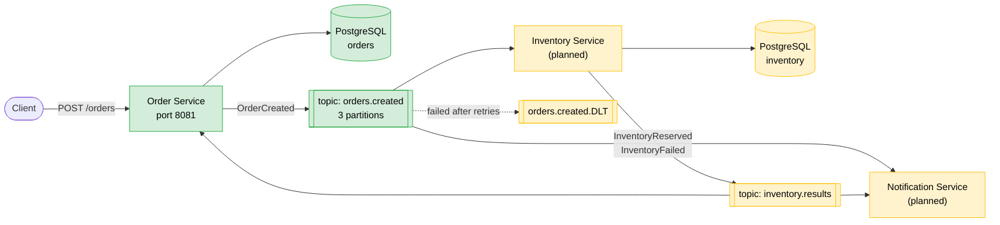
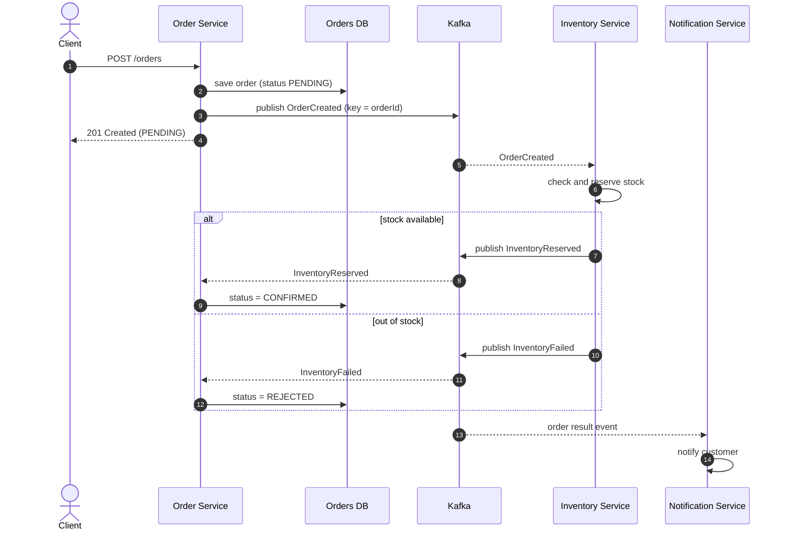
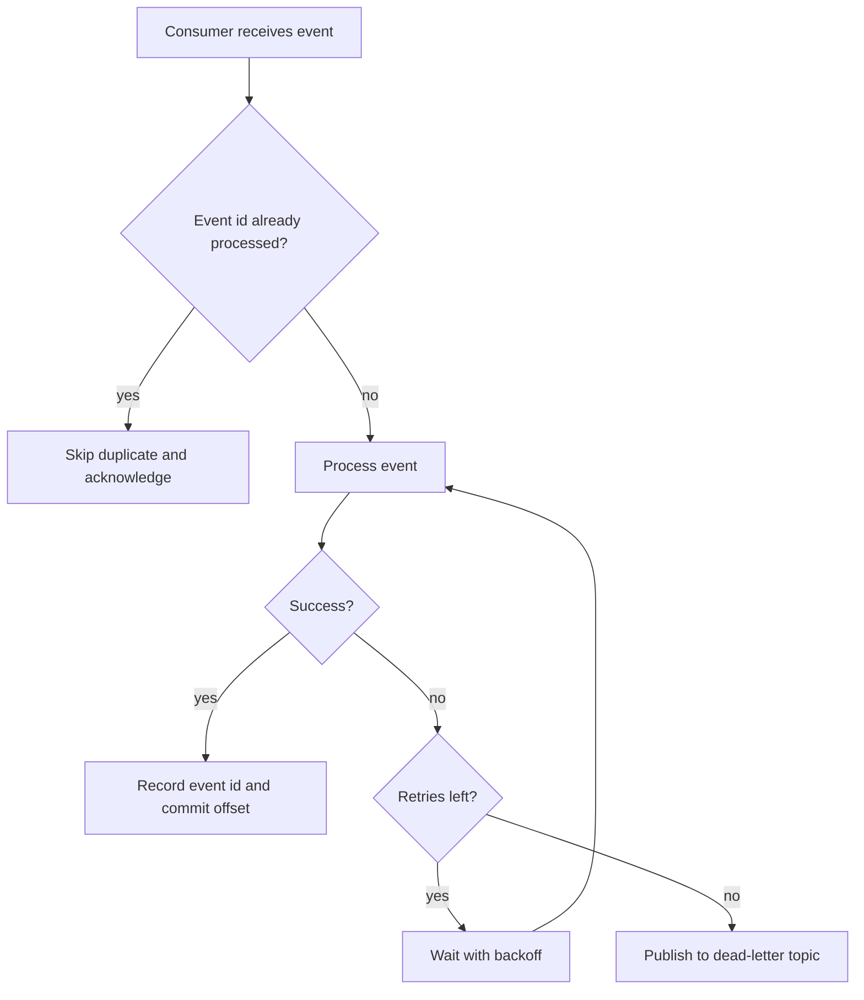
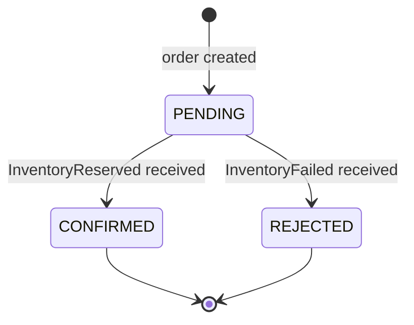

# Event-Driven Order Processing with Kafka and Spring Boot


An order processing system where services communicate through **events** instead of direct calls. When a customer places an order, the Order Service announces it on Kafka, and other services (inventory, notifications) react independently. No service needs to know who else is listening.

I built this to learn event-driven architecture and Apache Kafka from scratch, and to deal with the problems that come with distributed systems: duplicate messages, failures, ordering, and eventual consistency.

> **Project status:** In progress. The Order Service (REST API + PostgreSQL) works, and Kafka and Kafka UI run locally in Docker Compose. Event publishing, the Inventory and Notification services, and the reliability patterns are being built.
---

## Table of contents

1. [Why event-driven?](#why-event-driven)
2. [Architecture](#architecture)
3. [Event flow](#event-flow)
4. [Order lifecycle](#order-lifecycle)
5. [Kafka design](#kafka-design)
6. [Reliability and failure handling](#reliability-and-failure-handling-planned)
7. [Tech stack](#tech-stack)
8. [Getting started](#getting-started)
9. [API reference](#api-reference)
10. [Project structure](#project-structure)
11. [Design decisions and trade-offs](#design-decisions-and-trade-offs)
12. [Testing](#testing-planned)
13. [Screenshots](#screenshots)
14. [Roadmap](#roadmap)
15. [What I learned](#what-i-learned)

---

## Why event-driven?

In a request/response design, the Order Service would call the Inventory Service, then the Notification Service, and wait for each answer. That has three problems:

- **Tight coupling:** the Order Service must know every downstream service and its API.
- **Fragility:** if Inventory is slow or down, placing an order fails or hangs.
- **Hard to extend:** adding an Analytics service means changing the Order Service.

With events, the Order Service only records what happened (`OrderCreated`) and publishes it. Consumers subscribe on their own:

| | Request/response | Event-driven (this project) |
|---|---|---|
| Coupling | Caller knows every callee | Producer knows only the topic |
| If a downstream service is down | Request fails or times out | Events wait in Kafka and are processed on recovery |
| Adding a new consumer | Change the caller | Subscribe to the existing topic |
| Consistency | Immediate | Eventual (an order is `PENDING` until inventory responds) |

The trade-off is eventual consistency and more infrastructure, which are discussed under [Design decisions](#design-decisions-and-trade-offs).

---

## Architecture



Green = implemented, yellow = planned.

| Component | Responsibility | Status |
|---|---|---|
| **Order Service** | REST API, stores orders, publishes `OrderCreated`, updates order status from inventory results | REST API and database done |
| **Inventory Service** | Consumes `OrderCreated`, reserves stock, publishes `InventoryReserved` or `InventoryFailed` | Planned |
| **Notification Service** | Reacts to order and inventory events, notifies the customer | Planned |
| **Kafka (KRaft mode)** | Durable, ordered event log between services | Defined in Docker Compose |
| **PostgreSQL** | One database per service that owns data | Order DB done |

Each service owns its own data. Services never read each other's tables; they only exchange events.

---

## Event flow

### Happy path and rejection path



The client gets an immediate `201 Created` with status `PENDING`. The final outcome arrives asynchronously, which is why the order has a `PENDING` state at all.

### How a consumer handles each message (planned)



---

## Order lifecycle



A rejected order is the compensation step of the flow: when inventory cannot be reserved, the order is closed instead of being left pending.

---

## Kafka design

Topic and event names below are the target design; they are finalised as each service is implemented.

### Topics

| Topic | Producer | Consumers (group) | Key | Partitions |
|---|---|---|---|---|
| `orders.created` | Order Service | Inventory (`inventory-group`), Notification (`notification-group`) | `orderId` | 3 |
| `inventory.results` | Inventory Service | Order (`order-group`), Notification (`notification-group`) | `orderId` | 3 |
| `orders.created.DLT` | error handler | manual inspection | `orderId` | 1 |

### Why the order id is the message key

Kafka guarantees ordering only **within a partition**, and the key decides the partition. Using `orderId` as the key means every event about one order lands in the same partition and is processed in the order it was produced. Different orders are spread across partitions, so consumers scale horizontally (up to the partition count) without losing per-order ordering.

### Example event

```json
{
  "eventId": "b0a6c7e1-3f0e-4c1a-9a55-1d1f6f1f2a10",
  "eventType": "OrderCreated",
  "occurredAt": "2026-10-11T13:12:09Z",
  "orderId": "6d2be0f6-ed28-4cb9-bb2d-ff2b6bd06f54",
  "customerName": "Sidd",
  "productId": "P-100",
  "quantity": 2
}
```

`eventId` is unique per event and is what consumers use to detect duplicates.

---

## Reliability and failure handling (planned)

Distributed systems fail in partial ways. These are the patterns this project will implement and demonstrate.

| Problem | Solution |
|---|---|
| A consumer receives the same event twice (at-least-once delivery) | **Idempotent consumers:** store processed `eventId`s and skip repeats |
| A consumer throws an exception | **Retries with backoff**, then publish to a **dead-letter topic** so one bad message does not block the partition |
| A consumer crashes mid-processing | Offsets are committed only after successful processing, so the event is redelivered |
| A service is down for a while | Events stay in Kafka (retention) and are consumed when it returns |
| Saving to the database succeeds but publishing to Kafka fails | **Transactional outbox pattern** (stretch goal) |
| Ordering | Partition key = `orderId` |

**Delivery semantics:** the system targets **at-least-once delivery combined with idempotent processing**, which gives effectively-once results without the complexity of Kafka transactions.

---

## Tech stack

| Area | Technology |
|---|---|
| Language | Java (language level 21, built and tested on JDK 23) |
| Framework | Spring Boot 4.1, Spring Web, Spring Data JPA, Bean Validation |
| Messaging | Apache Kafka 3.9 (KRaft mode), Spring for Apache Kafka |
| Database | PostgreSQL 16 (Hibernate ORM) |
| Build | Maven (wrapper included) |
| Infrastructure | Docker, Docker Compose, Kafka UI |
| Utilities | Lombok |

---

## Getting started

### Prerequisites

- JDK 21 or newer
- Docker Desktop (with Docker Compose)
- An IDE such as IntelliJ IDEA

### 1. Start the infrastructure

```bash
docker compose up -d
docker compose ps
```

| Container | Purpose | Host port |
|---|---|---|
| `order-db` | PostgreSQL for the Order Service | 5433 |
| `kafka` | Kafka broker (KRaft, no ZooKeeper) | 9092 |
| `kafka-ui` | Web UI to browse topics, messages, consumer groups | 8090 |

Open Kafka UI at <http://localhost:8090>.

### 2. Run the Order Service

Run `OrderServiceApplication` from your IDE, or from a terminal:

```bash
cd order-service
./mvnw spring-boot:run
```

On Windows PowerShell use `.\mvnw.cmd spring-boot:run`. The service listens on <http://localhost:8081>.

### 3. Create an order

```powershell
Invoke-RestMethod -Method Post -Uri http://localhost:8081/orders `
  -ContentType "application/json" `
  -Body '{"customerName":"Sidd","productId":"P-100","quantity":2}'
```

### Stopping everything

```bash
docker compose down        # stops containers, keeps data
docker compose down -v     # also deletes the database volume
```

---

## API reference

### `POST /orders`

Creates an order with status `PENDING`.

Request:

```json
{
  "customerName": "Sidd",
  "productId": "P-100",
  "quantity": 2
}
```

Response `201 Created`:

```json
{
  "id": "6d2be0f6-ed28-4cb9-bb2d-ff2b6bd06f54",
  "customerName": "Sidd",
  "productId": "P-100",
  "quantity": 2,
  "status": "PENDING",
  "createdAt": "2026-10-11T13:12:09.406146Z"
}
```

Validation rules: `customerName` and `productId` must not be blank, and `quantity` must be at least 1. Invalid requests return `400 Bad Request`.

### `GET /orders/{id}`

Returns the order, or `404 Not Found` if the id is unknown.

---

## Project structure

```
kafka-project/
├── docker-compose.yml        PostgreSQL, Kafka (KRaft), Kafka UI
├── README.md
├── order-service/
│   └── src/main/java/com/sidd/orderservice/
│       ├── controller/       REST endpoints
│       ├── service/          business logic and transactions
│       ├── repository/       Spring Data JPA repositories
│       ├── model/            JPA entities and enums
│       └── dto/              request and response objects
├── inventory-service/        (planned)
├── notification-service/     (planned)
└── hello-app/                early practice project
```

---

## Design decisions and trade-offs

**Layered architecture with constructor injection.** Controllers handle HTTP only, services hold logic and transaction boundaries, repositories handle persistence. Dependencies are injected through constructors, which keeps classes easy to unit test with fakes.

**DTOs instead of exposing entities.** The API contract is independent of the table layout, and clients cannot set fields such as `id` or `status`.

**UUID primary keys.** They can be generated without a database round trip and are safe to embed in events shared across services. The cost is larger indexes than sequential integers.

**`EnumType.STRING` for status.** Reordering or adding enum constants does not corrupt existing rows.

**Table named `orders`.** `order` is a reserved SQL keyword.

**`open-in-view` disabled.** Database access stays inside the service layer instead of leaking into the web layer.

**`ddl-auto: update` in development only.** Convenient while learning. A production system would use versioned migrations (Flyway or Liquibase).

**Kafka in KRaft mode.** The broker also acts as the controller, which removes the separate ZooKeeper dependency and is how current Kafka versions are deployed.

**Two advertised Kafka listeners.** Containers reach the broker at `kafka:19092`, while applications on the host use `localhost:9092`. A client is only told one advertised address per listener, so each network needs its own.

**PostgreSQL on port 5433.** Port 5432 was already taken by a local installation on the development machine, which caused connections to hit the wrong database.

**Eventual consistency.** The caller sees `PENDING` immediately and the final state later. This is what makes the system resilient to a slow or failing inventory service, at the cost of a more complex client experience.

**Single broker, replication factor 1.** Fine for local development. A production cluster would run at least three brokers with replication factor 3 and `min.insync.replicas=2`.

---

## Testing (planned)

- **Unit tests** for the service layer with mocked repositories (JUnit 5, Mockito)
- **Integration tests** with Testcontainers running real PostgreSQL and Kafka
- **Failure scenarios demonstrated:**
  - Stop the Inventory Service, place orders, restart it, and verify it catches up with no lost events
  - Send a duplicate event and verify it is processed once
  - Force an exception and verify the message ends up in the dead-letter topic
- **Load test** with k6 to measure throughput on a local setup

---

## Screenshots

Add screenshots to `docs/images/` and uncomment the lines below once each one exists.

<!--
### Kafka UI: topics and messages


### Consumer groups and lag


### Creating an order


### Dead-letter topic after a forced failure

-->

---

## Roadmap

- [x] Order Service REST API with PostgreSQL (entity, repository, service, controller, validation)
- [x] Kafka and Kafka UI running in Docker Compose
- [ ] Publish `OrderCreated` with `orderId` as key
- [ ] Inventory Service: consume `OrderCreated`, reserve stock, publish result
- [ ] Order Service: update order status from inventory results
- [ ] Notification Service
- [ ] Retries with backoff and dead-letter topic
- [ ] Idempotent consumers
- [ ] Integration tests with Testcontainers
- [ ] Dockerfiles for every service and a single `docker compose up`
- [ ] Failure demonstrations and short demo video
- [ ] Stretch: transactional outbox pattern
- [ ] Stretch: metrics and consumer lag dashboard

---

## What I learned

- How topics, partitions, offsets, and consumer groups work, and why the message key controls ordering
- Why consumers must be idempotent when delivery is at-least-once
- How Kafka's advertised listeners differ between containers and the host
- Layered Spring Boot design, dependency injection, JPA entity mapping, and validation
- Debugging real environment problems: port conflicts, time zone mismatches between the JVM and PostgreSQL, and component scanning with mismatched packages

---

## Author

**Sidd** — [GitHub: sidvw1808](https://github.com/sidvw1808)
